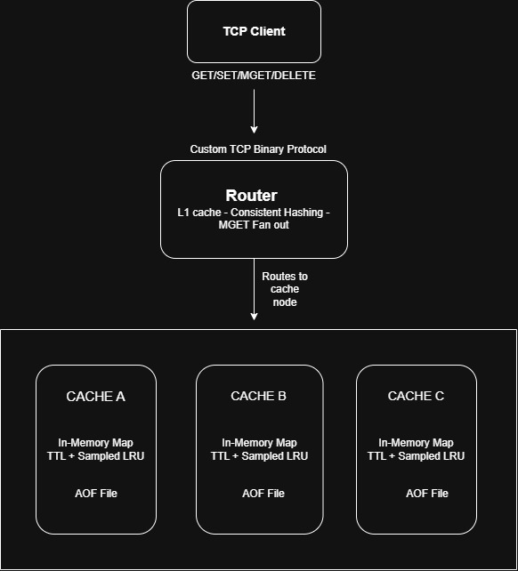

# Fridge — Distributed Cache

A personal systems programming project to understand how distributed caching
systems like Redis work internally.

Fridge is a lightweight, Redis-inspired cache built with **TypeScript, Node.js
TCP sockets, and Docker**. It explores cache operations, binary protocol design,
consistent hashing, multi-node routing, eviction strategies, and append-only
file persistence.

This is a learning project focused on understanding system design concepts
through implementation, not a production-ready Redis replacement.

## Architecture

> 

The system consists of a TCP client, a router, and three independent cache nodes.

- The router distributes requests across cache nodes using consistent hashing.
- Each cache node maintains its own in-memory key-value store.
- A small L1 cache in the router speeds up repeated reads.
- Each cache node maintains its own append-only file (AOF) for restoring data after a restart.

## Features

- **TCP communication:** Custom binary request and response protocol with message framing.
- **Cache operations:** `GET`, `SET`, `DEL`, and `MGET`.
- **Consistent hashing:** Distributes keys across multiple cache nodes using virtual nodes.
- **TTL expiration:** Supports time-to-live values for cached entries.
- **Sampled-LRU eviction:** Samples candidate keys and evicts the least recently accessed key among them.
- **L1 caching:** Caches frequently requested values in the router to reduce repeated network requests.
- **Multi-key reads:** Fans out `MGET` requests to the relevant nodes and combines the results.
- **AOF persistence:** Appends write operations to a log and replays the log when a cache node starts.
- **Docker Compose:** Runs the router and three cache nodes as separate containers.
- **Benchmarking:** Includes scripts to measure throughput and request latency.

## Tech Stack

- TypeScript and Node.js
- TCP sockets using `node:net`
- Docker and Docker Compose
- Custom binary protocol
- Consistent hashing
- In-memory data structures
- Append-only file persistence

## Running Locally

### Prerequisites

- Node.js
- npm
- Docker with Docker Compose

### Start the cluster

Clone the repository and install dependencies:

```bash
git clone <YOUR_GITHUB_REPOSITORY_URL>
cd fridge
npm install
```

Build and start the services:

```bash
docker compose up --build
```

The default host ports are:

| Service      | Host port |
| ------------ | --------: |
| Cache node A |      5001 |
| Cache node B |      5002 |
| Cache node C |      5003 |
| Router       |      4000 |

The router communicates with the cache nodes over Docker's internal network.

Use the included TCP client and benchmark scripts to test cache operations and routing.

To stop the services:

```bash
docker compose down
```

The cache nodes use separate named Docker volumes for their AOF files. Stopping the containers without removing the volumes preserves those files for subsequent restarts.

## Benchmark

A local benchmark of repeated hot-key reads through the router produced the following results:

| Metric              |               Result |
| ------------------- | -------------------: |
| Requests            |               10,000 |
| Successful requests |               10,000 |
| Concurrency         |                   50 |
| Throughput          | ~37,122 requests/sec |
| P50 latency         |             0.775 ms |
| P95 latency         |             2.745 ms |
| P99 latency         |             4.709 ms |

These results reflect a local test workload that benefits heavily from the router's L1 cache. They are not a general performance comparison against Redis or a guarantee of production throughput.

## Limitations

This project intentionally focuses on core concepts rather than production completeness.

- No replication or automatic failover between cache nodes.
- The router's L1 cache is local to that router and does not provide cross-router invalidation.
- Cache capacity is configured by entry count rather than a strict memory-byte limit.
- AOF persistence does not provide a complete production-grade durability and recovery guarantee.
- No authentication, TLS, or production observability setup.

## What I Learned

Building Fridge helped me explore:

- How TCP servers communicate using a custom binary protocol.
- Why TCP message framing is necessary when data arrives in arbitrary chunks.
- How consistent hashing maps keys to nodes.
- The trade-offs between exact and approximate cache eviction.
- How TTL expiration and multi-key operations work.
- How an L1 cache affects latency and cache hit rates.
- How append-only logs can restore state after a process restart.
- How Docker Compose connects multiple services in a local distributed system.
- How to measure throughput and latency and interpret benchmark results.

## Project Status

Core learning implementation completed. Further production hardening and deployment are out of scope for this version.
